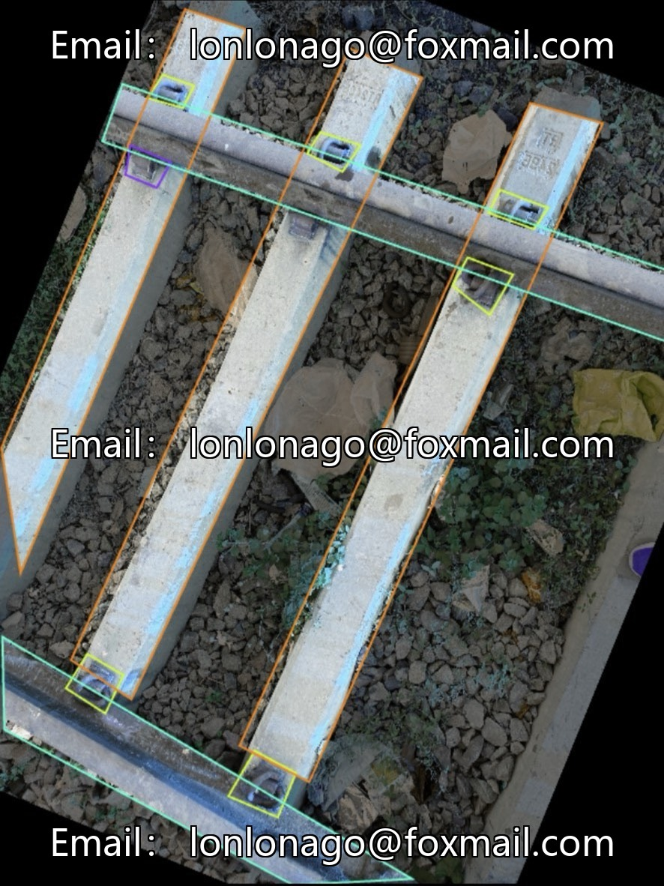
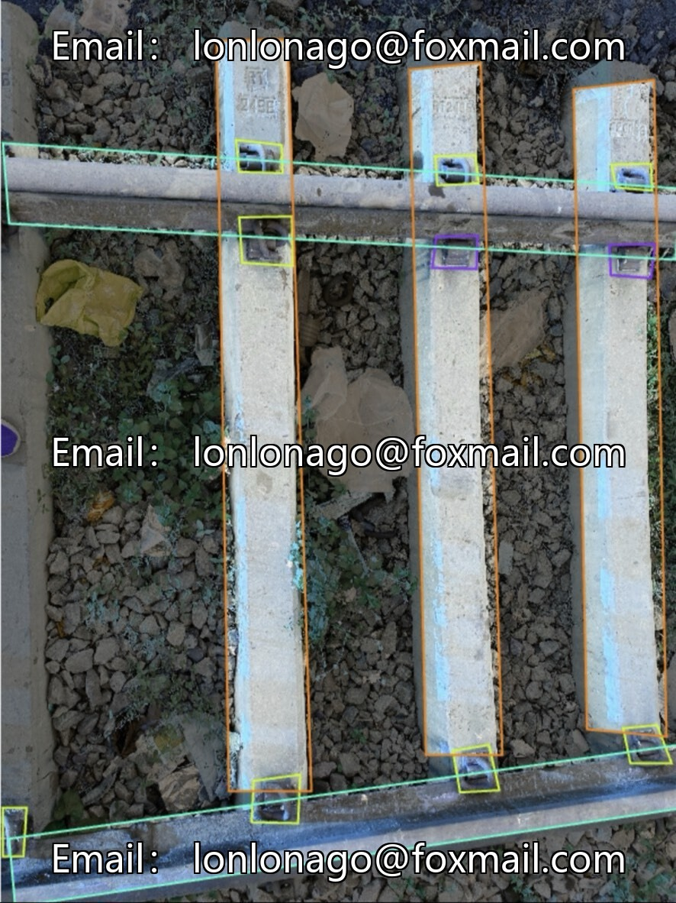
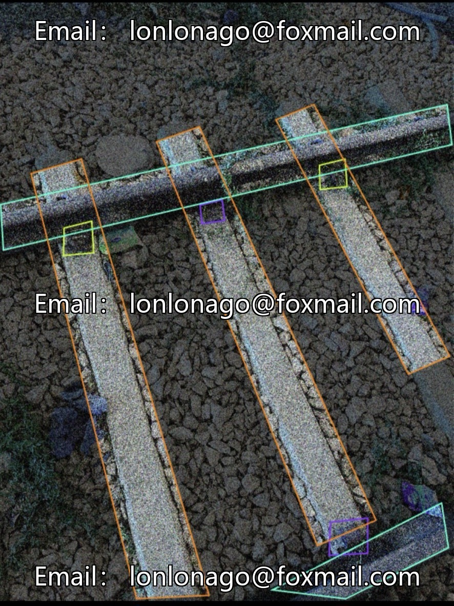
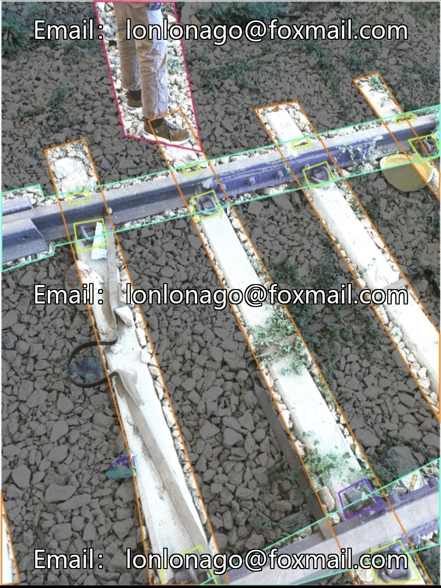
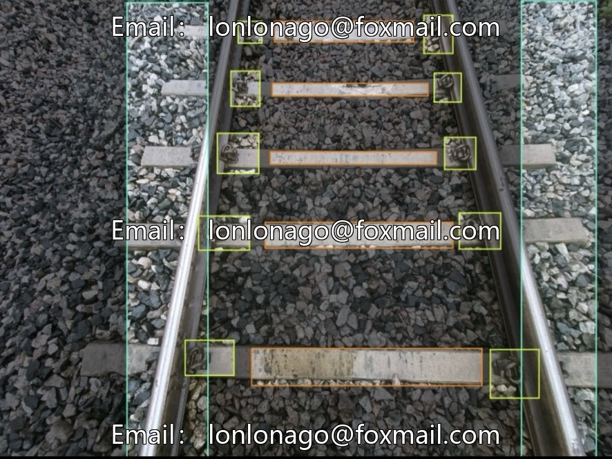

# Railway Track Parts YOLO Detection Dataset | Issue 10760

## Body

Railway Track Parts YOLO Detection Dataset | Issue 10760
393 close-up images of railway tracks, excluding blurred and incorrectly labeled samples, suitable for scenarios such as intelligent inspection of railways, track components, fastener defects, and track foreign objects.
Compatible with three mainstream formats: YOLO, VOC, COCO, ready to use out of the box, no conversion required.
Real-world conditions include gravel obstructions, backlighting, and overlapping small parts, representing real-life inspection interference scenarios.
Five major label categories: track obstacles, fasteners, missing fasteners, rails, sleepers, capable of simultaneously identifying three types of safety hazards: the track itself, fastener defects, and intrusion of foreign objects.

Comprehensive YOLO training code, based on the YOLOv8 lightweight model, with fixed training parameters: 26 iterations, input size of 640, batch size of 4, early stopping to prevent overfitting, GPU acceleration;
Inclusion of inference code, outputting detection results with labeled boxes upon inputting track images, can be run by simply configuring a YAML category file.
Adaptable for train inspection cameras on trains, monitoring along the rail line, portable detection terminals;
Automatically outputting missing fastener points and track foreign object warnings, supporting railway automation operation and maintenance inspection.
Virtual materials, once sold, are non-refundable.
Interested friends, click "I want" now.

## Images

## Payment

Here is a pay link on Stripe ( https://buy.stripe.com/3cs8yP7sY87d0vu9AB ). Please contact me lonlonago@foxmail.com after funding $89, and I will send you a complete data files , thank you!

